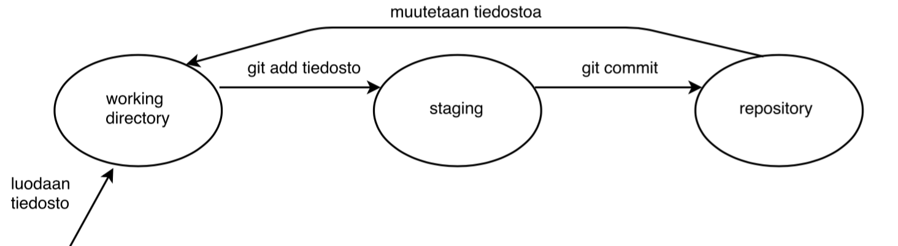

_This guide is a copy of the [Git tutorial](https://ohjelmistotekniikka-hy.github.io/python/viikko1#versionhallinta-tee-n%C3%A4m%C3%A4-harjoitukset-jos-ei-tunnu-tutulta) of the course Ohjelmistotekniikka (Software Development Methods), with a few additions. The linked original is in Finnish._

Next, we get to know version control.

What is meant by version control? A quote from the page [https://www.atlassian.com/git/tutorials](https://www.atlassian.com/git/tutorials)

> Version control systems are a category of software tools that help a software team manage changes to source code over time. Version control software keeps track of every modification to the code in a special kind of database. If a mistake is made, developers can turn back the clock and compare earlier versions of the code to help fix the mistake while minimizing disruption to all team members.

Although the quote above talks about version control in the context of software teams, you should really use version control even in one-person projects, and for managing other kinds of material than code as well. For example, all the material of this course is stored in version control.

Nowadays the most popular version control software is [git](https://git-scm.com). Today we get to know the basics of git.

**NOTE:** The Git exercises must be done on a computer that has Git installed. On many computers running macOS or Linux, Git comes preinstalled. You can check this by running the following command in your computer's terminal:

```bash
git --version
```

If the command does not print a Git version number, see the [Git installation instructions](https://git-scm.com/book/en/v2/Getting-Started-Installing-Git). On Windows computers, you can use for example the [Windows Subsystem for Linux](https://tkt-lapio.github.io/#windows-subsystem-for-linux) tool for installing and running the commands.

If, on the other hand, the git version printed by the command is lower than 2.23.0, the `git restore` command used in the following exercises does not work. You can, however, use the commands `git reset HEAD` and `git checkout`, about which you can find more information in the [material of the course Tietokone työvälineenä](https://tkt-lapio.github.io/git/) (Computer as a Tool, in Finnish).

### Git configuration

Open a terminal on your own machine. **So the following exercises are done locally, not on the department's melkki servers!**

Define **your own name** and **the email address you use** for git by giving the commands:

```
 git config --global user.name "Your Name"
 git config --global user.email you@example.com
```

Make sure with the command `git config -l` that the definitions went right.

Let's also set git to use suitable colours with the command `git config --global color.ui` and **change git's default editor to nano** with the command `git config --global core.editor nano`

If you use vim, you can leave the default editor unchanged.

Also make the following configuration:

```
git config --global push.default matching
```

This is related to the default behaviour of the `git push` command. More about the command later.

### Repository

Now create a suitable directory for practising git and go to the directory, i.e. give for example the commands:

- `mkdir ohtu-git-warmup`
- `cd ohtu-git-warmup`

**NOTE:** now make sure you are in the directory you created, i.e. if you run the command _ls_, there should be nothing in the directory.

Let's turn the directory into a local _git repository_ by giving the command `git init`

Git reports that it has initialised the repository:

```
$ git init
Initialized empty Git repository in /Users/mluukkai/opetus/ohtu24/koodi/viikot/lh1/ohtu-git-warmup/.git/
```

If you look at the contents of the directory with the command `ls -la`, you notice that a directory `.git` has appeared inside it. Git uses the created directory to keep track of the files stored in the repository.

**NOTE:** since the name of the directory (_.git_) starts with a dot, the command `ls` does not show it by default. The parameter _a_ also shows files and directories starting with a dot. Try how `ls -a` and `ls -la` differ from each other!

Stay in the directory _ohtu-git-warmup_ containing your repository.

Create a file named _tiedosto.txt_ in the directory, e.g. with the command `touch`. After creating the file, run the command `git status`:

```
$ touch tiedosto.txt
$ git status
On branch main

No commits yet

Untracked files:
  (use "git add <file>..." to include in what will be committed)

	tiedosto.txt

nothing added to commit but untracked files present (use "git add" to track)
$
```

Git reports that there is a file in the state _untracked_, i.e. the file has not been added to version control.

As the output of the command says, adding the file under git (...to include in what will be committed) is done with the command `git add tiedosto.txt`

Do the addition and then run the command `git status`:

```
$ git add tiedosto.txt
$ git status
On branch main

No commits yet

Changes to be committed:
  (use "git rm --cached <file>..." to unstage)

	new file:   tiedosto.txt
```

Git now tells you that _tiedosto.txt_ is among the changes that can be _committed_.

### Commits

Committing means saving files and directories, and the changes related to them, in the _git repository_.

Let's commit by giving the command `git commit -m "tiedosto.txt luotu"` (the message means "tiedosto.txt created")

```
$ git commit -m "tiedosto.txt luotu"
[main (root-commit) 0e12cfa] tiedosto.txt luotu
 1 file changed, 0 insertions(+), 0 deletions(-)
 create mode 100644 tiedosto.txt
```

Run the command `git status` again

```
$ git status
On branch main
nothing to commit, working tree clean
```

Git reports _working tree clean_, i.e. your directory is in the same state as the git repository.

### Working directory, index and staging

When you make changes to the files (or directories) under your directory, the changes apply to the _working directory_.

- Make some change to the file tiedosto.txt
- Create a new file named _toinen.txt_ in the directory

Run `git status` again

```
$ git status
On branch main
Changes not staged for commit:
  (use "git add <file>..." to update what will be committed)
  (use "git restore <file>..." to discard changes in working directory)
	modified:   tiedosto.txt

Untracked files:
  (use "git add <file>..." to include in what will be committed)

	toinen.txt

no changes added to commit (use "git add" and/or "git commit -a")
```

Git now reports that the new file is _untracked_ and that the earlier file has changes that are not _staged for commit_.

Let's follow the instructions, i.e. add the changes and the new file to the set of things to be committed. "Adding" both files at once is done with the command `git add .`

Let's check the situation again with the command `git status`

```
$ git status
On branch main
Changes to be committed:
  (use "git restore --staged <file>..." to unstage)
	modified:   tiedosto.txt
	new file:   toinen.txt
```

Both the change and the new file are now ready to be committed.

Committing is done with the command `git commit`. As last time, the command is given a _commit message_ as a parameter, i.e. a string that describes what changes the new commit brings compared to the previous one:

`git commit -m "muutos ja lisäys"`

After committing, check the situation again with the command `git status`.

**NOTE** if you accidentally commit without a commit message, i.e. without the parameter `-m`, git opens a text editor and assumes that you want to write the commit message in the editor. If you did not set nano as git's editor as instructed at the beginning, the default editor _vim_ opens, and you may have to google how to get out of the editor.

So files and the changes made to them can be in _three different states_ as far as git is concerned.

- At first, files (or the changes made to them) are only in the _working directory_, and git does not take note of them until they are added with the command `git add`
- After this, the files are ready to be committed. In git's terminology, files that are ready to be committed are in the _staging_ area
- The command `git commit` moves the changes in staging into the repository, i.e. creates a new _commit_

The following image illustrates how the _state_ of a file changes when git commands are run.



When a file is created, it goes into git's _working directory_. With the command _git add_ the file moves to the _staging_ area, i.e. ready to be committed. A file in staging is taken (i.e. "committed") into the repository with the command _git commit_. When a committed file is edited again, the changes go into the _working directory_ again.

### Git log

So every run of the command _git commit_ creates a new commit, i.e. a new "state", in the repository. With the command `git log` you can see which commits the repository contains:

```
$ git log
commit cb3a2401ba8bd50a891c883a6666c9cd76459115 (HEAD -> main)
Author: Matti Luukkainen <mluukkai@iki.fi>
Date:   Mon Oct 14 11:54:22 2024 +0300

    muutos ja lisäys

commit a6acd9eb3f83d34255ff66cc55ff757036f65ea2
Author: Matti Luukkainen <mluukkai@iki.fi>
Date:   Mon Oct 14 11:51:55 2024 +0300

    tiedosto.txt luotu
$
```

The git log tells the time, author, message and _identifier_ of each commit. The identifiers are used if there is a need, for example, to return to the state of some old commit.

You can browse the log with the arrow keys. You get out of `git log` by pressing _q_.

### Practice

Remember to use the command `git status` as often as possible. Don't forget tab completion either!

- Create a file _kolmas.txt_
- Add it to be committed and commit
- Change the contents of the files _toinen.txt_ and _kolmas.txt_ and commit the changes
- Create a directory _stuff_ and some file inside it
- Add the changes to be committed and commit
  - Note that adding the directory is enough; the files it contains are added automatically
- See what the git log looks like

### gitk

You can also view git commits with the graphical command _gitk_.

- On Windows, the `gitk` command works at least in the Git Shell of GitHub for Windows.
- You can install `gitk` on a Mac with [Homebrew](https://git-scm.com/install/mac) with the command `brew install git-gui`
  - If `gitk` does not work for some reason, you can install the [Sourcetree](https://www.sourcetreeapp.com) tool

Run the command in the repository:


In the top left corner you see all the commits. The current situation is at the top. By clicking a commit, you see information related to the commit in the other windows. In the bottom right corner you see the files that changed in the commit (if the selection is _patch_) or the files that existed in the repository at the time of the commit (if the selection is _tree_). In the bottom left corner you can examine the changes the commit made to the files or the state of the files at the time of the commit. The options are a bit confusing, since they work differently depending on the mode on the right side.

While doing the next exercise, it is a good idea to open a new tab in the terminal so that you can keep gitk running.

- Copy a lot of text from somewhere into the file _tiedosto.txt_ and commit the file
- Now remove part of the text in the file and add some more text to the file
- commit after the changes
- Update the gitk view (file/update) and see how the changes are shown (look at the two topmost commits)
  - Choose _patch_ in the bottom right corner and _diff_ on the left
  - This way you see the changes caused by the commit in [diff](https://en.wikipedia.org/wiki/Diff) format
  - If _tree_ is selected on the right, the left side shows (regardless of the selection) the state of the files at the time of the commit
- If you use Sourcetree, it should update automatically and show the change in _diff_ format

### Deleting and renaming a file

- Delete the file _toinen.txt_
- Run `git status`
- Commit the change
  - First remove the file from git with the command `git rm`
- make sure with the command `git status` that everything is as it should be
- rename the file _tiedosto.txt_ to _eka.txt_
  - renaming is done with the command `mv`
- Run `git status`
  - How does git handle the renaming?
- Commit the change

### git add -p

- Make some changes to the files _eka.txt_ and _kolmas.txt_
  - Make both additions and deletions
- add them to be committed with the command `git add -p`
  - Git now shows each change you made in _patch_ format and asks you to confirm whether the change is added to be committed
  - Accept by pressing _y_ and enter
- Commit the changes
- _Always_ add changes made to files to be committed with the command `git add -p`; this way you can check that the changes are exactly the ones you think you are adding
  - Note that completely **new files are not moved to be committed** with the command `git add -p`

### Undoing changes

Sometimes you make changes to files that need to be undone

- Now make some change to the file _eka.txt_, **do not** add the file to be committed
- Run the command `git status`

```
$ git status
On branch main
Changes not staged for commit:
  (use "git add <file>..." to update what will be committed)
  (use "git restore <file>..." to discard changes in working directory)
	modified:   eka.txt

no changes added to commit (use "git add" and/or "git commit -a")
```

As expected, git tells us that we have made changes that are not "staged for commit", i.e. added to be committed.

- Let's decide to undo the changes after all. This is done with the command `git restore eka.txt`
- When you run the command `git status` again, you notice that the working directory no longer contains changes:

```
$ git restore eka.txt
$ git status
On branch main
nothing to commit, working trean clean
```

- Also make sure that the contents of the file are the same as before the changes

A change that has been moved to staging, i.e. is ready to be committed, can also be undone.

- Make changes to the file _kolmas.txt_ and add it to be committed. **Do not** commit, though.
- Git status should look like this

```
$ git status
On branch main
Changes to be committed:
  (use "git restore --staged <file>..." to unstage)

	modified:   kolmas.txt

```

Instructions for undoing the change can be found in the output of git status.

- Run the command that undoes the changes, `git restore --staged kolmas.txt`
- Let's look at `git status` again

```pre
$ git status
On branch main
Changes not staged for commit:
  (use "git add <file>..." to update what will be committed)
  (use "git restore <file>..." to discard changes in working directory)

	modified:   kolmas.txt

no changes added to commit (use "git add" and/or "git commit -a")
```

So the file is no longer in the _staged_ state, but the changes are still in the _working directory_, i.e. if you look at the contents of the file, the changes still exist

- You can undo the changes completely by giving the command `git restore kolmas.txt`
- Make sure that the file has returned to the state before the changes

Below is the diagram describing the state of a file, now completed: if a file has been added to be committed, i.e. it is _staged_, the change can be undone with the command `git restore --staged`. In that case, however, the changes still remain in the file, i.e. they are in the _working directory_. The file can be restored to the state of the previous commit in the repository with the command `git restore`.


### Practice

- create a directory _tiedostoja_ inside your repository and the files _file1_, _file2_ and _file3_ inside the directory
- commit the changes
  - remember how you can add the contents of a whole directory to be committed with one command
- change the contents of the file _file1_ and delete the file _file2_
- undo the changes!
- change the contents of the file _file3_, add it to be committed
- undo the changes!
- delete the file _file1_ and rename the file _file2_ to _file22_
- commit
